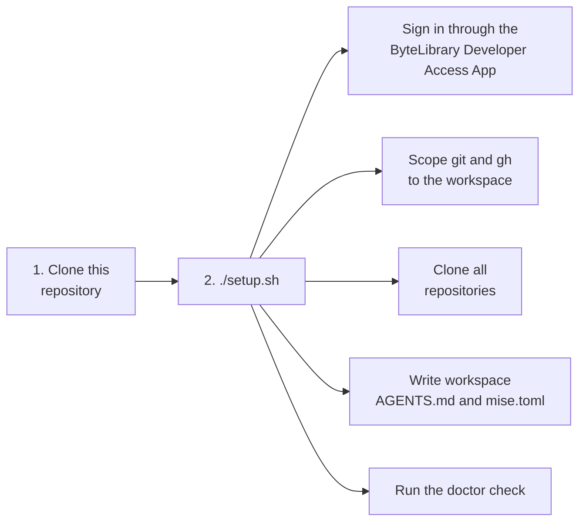

# workbench

Sets up a development workspace on a new machine: scoped GitHub access, all
repositories cloned into `~/ByteLibrary/`, workspace-level agent instructions, and a check that
everything works. Decided in ADR-0023 and ADR-0026 of the handbook.



## Prerequisites
Tested on **Ubuntu on WSL2**.

| Tool | Install |
|---|---|
| git | `sudo apt install git` |
| Python 3 with PyYAML | `sudo apt install python3 python3-yaml` (reads the handbook's data) |
| GitHub CLI (`gh`) | `sudo apt install gh` |
| mise | See [mise installation](https://mise.jdx.dev/installing-mise.html), then add `eval "$(mise activate bash)"` to `~/.bashrc` |
| Docker Engine | See [Docker Engine for Ubuntu](https://docs.docker.com/engine/install/ubuntu/), then add yourself to the `docker` group |

Docker Engine runs directly inside WSL2; Docker Desktop is not needed.

## Setup
You need a GitHub account that is a member of ByteLibrary.

1. **Clone this repository.** It is public, so no sign-in is needed yet:
   ```bash
   git clone https://github.com/ByteLibrary/workbench.git ~/ByteLibrary/workbench
   ```
2. **Run the setup**, and answer its questions. It signs you in through the ByteLibrary Developer
   Access App ([docs/github-access.md](docs/github-access.md)):
   ```bash
   ~/ByteLibrary/workbench/setup.sh
   ```

### Without questions
For CI, setup runs without asking anything when these environment variables are set (see the
handbook's configuration and secrets convention):

| Variable | Value |
|---|---|
| `BYTELIBRARY_GITHUB_TOKEN` | A token to use instead of signing in. It goes to `gh` and to the workspace's git credentials |
| `BYTELIBRARY_COMMIT_NAME`, `BYTELIBRARY_COMMIT_EMAIL` | The commit identity |

Every question is then answered no, and the doctor skips the checks of a person's sign-in. CI's
"Setup on a fresh machine" job runs it this way on every pull request, with a one-hour token from the
ByteLibrary CI App (`CI_APP_CLIENT_ID` and `CI_APP_PRIVATE_KEY`, see [docs/github-access.md](docs/github-access.md)).

## What the setup changes

| Where | Change |
|---|---|
| `~/.config/gh-bytelibrary/` | The `gh` sign-in through the ByteLibrary Developer Access App |
| `~/.config/bytelibrary/git-credentials` | The same sign-in for git, readable only by you |
| `~/.gitconfig-bytelibrary` | Commit identity, GitHub credentials and the organization's git hooks (`hooks/`) for workspace repositories |
| `~/.gitconfig` | One `includeIf` line that loads the file above only under `~/ByteLibrary/`. With your confirmation, removes machine-wide GitHub credential helpers (a backup is kept). |
| `~/ByteLibrary/` | All repositories, plus the workspace `AGENTS.md`, `mise.toml` and `ByteLibrary.code-workspace` (opens every repository in VS Code) |
| `~/.local/bin/playbook` | The [playbook](https://github.com/ByteLibrary/playbook)'s command, installed by its own installer |
| `~/.agents/skills/bytelibrary-*` | The playbook's skills, in the shared location agent CLIs read skills from |
| `~/.config/systemd/user/` | `bytelibrary-update.timer` and its service, which update the workspace every 10 minutes |
| `~/.bashrc` | With your confirmation, one line that shows the update report when a terminal opens |

Nothing outside the workspace uses the sign-in.

## Commands
Every script is safe to run again.

| Command | Does |
|---|---|
| `./setup.sh` | Full setup |
| `mise run update` | Updates the workspace now, as the background update does every 10 minutes |
| `scripts/sign-in.sh` | Signs in through the App again, for example after revoking access |
| `scripts/doctor.sh` | Checks tools, GitHub access, that the handbook's data matches GitHub, repository settings, the workspace (every repository uses the git hooks, no checked-out `main` behind GitHub), and shows the latest update report |
| `scripts/clone-repositories.sh` | Clones repositories added to the organization since the last run |
| `scripts/write-workspace-files.sh` | Rewrites the workspace `AGENTS.md` and `mise.toml` after they change here |
| `scripts/install-playbook.sh` | Installs the playbook's command and skills again |
| `scripts/configure-git-hooks.sh` | Makes every workspace repository use the organization's git hooks |
| `scripts/test-hooks.sh` | Tests the git hooks in a throwaway workspace (also run by CI) |
| `scripts/test-update.sh` | Tests the workspace update in a throwaway workspace (also run by CI) |

Scripts that work on every repository only include repositories that follow the handbook's
conventions, identified by a kind topic. The kinds are read from the handbook's
`data/repository-kinds.yaml`, so `clone-repositories.sh` clones the handbook first.

The doctor compares the handbook's data with GitHub in both directions: every repository in
`data/repositories.yaml` (existence, visibility, description, topics) and every repository on GitHub
with a kind topic, plus the project's Context options against `data/contexts.yaml`.

## Keeping up to date
Every 10 minutes, `scripts/update.sh` fetches every workspace repository, fast-forwards `main` where it
is checked out without local changes, and clones new repositories. A changed or new `playbook` is installed again. It never switches branches, stashes,
rebases, merges, deletes, re-runs setup or uses `sudo`: anything that needs a decision is only reported
in `~/ByteLibrary/.workspace-update.md`, for example a branch behind `main`. The doctor shows the report,
and so does a new terminal if you agreed to it during setup. Runs never overlap, and a repository with a
git operation in progress is skipped until the next run.

## Skills for agent CLIs
Setup installs the playbook's skills in `~/.agents/skills/`, the location the Agent Skills format
uses for sharing skills between agent CLIs.

> **Note:** an agent CLI that does not read `~/.agents/skills/` does not see the skills until you point it
> there, for example by linking that folder into the CLI's own skills folder.

## Git hooks
Every workspace repository uses the hooks in `hooks/` (ADR-0024 of the handbook). They run
the rules script from the workspace clone of `reusable-ci-workflows`, the same one CI uses:

| Hook | Refuses |
|---|---|
| `commit-msg` | A message that is not a Conventional Commit (merge commits keep git's own subject), co-author trailers, attribution, and agent tool or vendor names |
| `pre-push` | Pushing to or deleting `main`, and branch names that do not follow `<type>/<issue-number>-<short-description>` |

`--no-verify` skips them; CI and, in public repositories, the `main` ruleset still apply.

## Troubleshooting

| Problem | Fix |
|---|---|
| `gh` says you are not logged in inside the workspace | Your shell does not have `GH_CONFIG_DIR` set. Check that mise is activated in `~/.bashrc` and run `mise trust ~/ByteLibrary/mise.toml`. |
| The doctor says you are not signed in through the App | Run `scripts/sign-in.sh`. If the workspace still uses a personal access token, `setup.sh` offers the switch. |
| The doctor reports a difference between the handbook's data and GitHub | Decide which one is wrong. Fix the handbook's data through a pull request, or fix GitHub (an owner) so it matches. |
| The doctor reports that repository settings differ | An owner applies the repository settings from the handbook's repository conventions to that repository. |
| `git push` asks for a password | The repository is outside `~/ByteLibrary/`, or setup has not run. Run `./setup.sh`. |
| Docker checks fail | Start the daemon (`sudo service docker start`) and check you are in the `docker` group. |
| git or `gh` is refused after you revoked access | Run `scripts/sign-in.sh`. |
