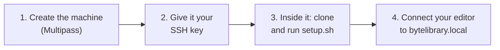

# workbench

Creates and configures the development machine: an Ubuntu virtual machine with the tools, sign-in, git
hooks, the workspace and its updates, which you reach from your editor over SSH. Decided in ADR-0023,
ADR-0026 and ADR-0028 of the handbook.



## Prerequisites
**Windows only:** enable Hyper-V. Run this in PowerShell as administrator, then restart:
```powershell
Enable-WindowsOptionalFeature -Online -FeatureName Microsoft-Hyper-V -All
```

**Everyone:**
1. [Multipass](https://canonical.com/multipass/install).
2. An SSH key: if `$HOME/.ssh/id_ed25519.pub` does not exist, run `ssh-keygen -t ed25519`.
3. An editor that works over SSH (see [Editors](#editors)).
4. A GitHub account that is a member of ByteLibrary.

## Setup
Run these commands in any terminal; they are the same on every operating system.

1. **Create the machine.** Adjust the size to your computer; this leaves room for services and agents:
   ```
   multipass launch 24.04 --name bytelibrary --cpus 6 --memory 12G --disk 60G
   ```
2. **Give it your SSH key,** so your editor can connect:
   ```
   multipass exec bytelibrary -- sh -c "echo '$(cat $HOME/.ssh/id_ed25519.pub)' > /home/ubuntu/editor-ssh-key.pub"
   ```
3. **Set it up.** Open a shell in the machine, clone this repository (it is public) and run setup, which
   asks a few questions and signs you in through the ByteLibrary Developer Access App
   ([docs/github-access.md](docs/github-access.md)):
   ```
   multipass shell bytelibrary
   git clone https://github.com/ByteLibrary/workbench.git ~/ByteLibrary/workbench
   ~/ByteLibrary/workbench/setup.sh
   ```
4. **Connect your editor.** Add this to `$HOME/.ssh/config` on your computer, then connect to
   `bytelibrary` from your editor:
   ```
   Host bytelibrary
     HostName bytelibrary.local
     User ubuntu
   ```
   The machine announces its name on the local network, so it is found even when its address changes.

Setup installs everything else itself, at versions pinned in git:

| What | From |
|---|---|
| git, curl, CA certificates, Python 3 with PyYAML (for setup's own scripts), avahi-daemon (announces `bytelibrary.local`) | Ubuntu's packages |
| Docker Engine, and the `docker` group for you | Docker's repository |
| mise, then `gh`, Python and ShellCheck for the workspace, and each repository's own tools | mise's installer and `mise install` |

### Daily use

| Do | Command, on your computer |
|---|---|
| Stop the machine and free its memory | `multipass stop bytelibrary` |
| Start it again | `multipass start bytelibrary` |

### Editors
Any editor that works over SSH works: the rules live in each repository's tools, and language servers
run inside the machine. Zed and VS Code are recommended, and every repository ships settings for both.

| Editor | Connect |
|---|---|
| [Zed](https://zed.dev) | Open Remote Project → `bytelibrary` |
| [VS Code](https://code.visualstudio.com) | Install the Remote - SSH extension → Connect to Host → `bytelibrary`, then open `~/ByteLibrary/ByteLibrary.code-workspace` |

### Agent CLIs
Install the agent CLI you use **inside the machine**, never on your computer, and sign in with your own
subscription. The machine is the agents' sandbox: nothing from your computer is mounted into it.

### Without questions
For CI, setup runs without asking anything when these environment variables are set (see the
handbook's configuration and secrets convention):

| Variable | Value |
|---|---|
| `BYTELIBRARY_GITHUB_TOKEN` | A token to use instead of signing in. It goes to `gh` and to the workspace's git credentials |
| `BYTELIBRARY_COMMIT_NAME`, `BYTELIBRARY_COMMIT_EMAIL` | The commit identity |

Every question is then answered no, and the doctor skips the checks of a person's sign-in. CI's
"Setup" check runs it this way on every pull request, with a one-hour token from the
ByteLibrary CI App (`CI_APP_CLIENT_ID` and `CI_APP_PRIVATE_KEY`, see [docs/github-access.md](docs/github-access.md)).

## What the setup changes

| Where | Change |
|---|---|
| `~/.ssh/authorized_keys` | Your editor's SSH key, from step 2 |
| `~/.config/gh-bytelibrary/` | The `gh` sign-in through the ByteLibrary Developer Access App |
| `~/.config/bytelibrary/git-credentials` | The same sign-in for git, readable only by you |
| `~/.gitconfig-bytelibrary` | Commit identity, GitHub credentials and the organization's git hooks (`hooks/`) for workspace repositories |
| `~/.gitconfig` | One `includeIf` line that loads the file above only under `~/ByteLibrary/`. With your confirmation, removes machine-wide GitHub credential helpers (a backup is kept). |
| `~/ByteLibrary/` | All repositories, plus the workspace `AGENTS.md`, `mise.toml` and `ByteLibrary.code-workspace` (opens every repository in VS Code) |
| `~/.bashrc` | With your confirmation, one line that activates mise in new shells |
| `~/.local/bin/playbook` | The [playbook](https://github.com/ByteLibrary/playbook)'s command, installed by its own installer |
| `~/.agents/skills/bytelibrary-*` | The playbook's skills, in the shared location agent CLIs read skills from |
| `~/.config/systemd/user/` | `bytelibrary-update.timer` and its service, which update the workspace every 10 minutes |
| `~/.bashrc` | With your confirmation, one line that shows the update report when a terminal opens |
| `/etc/systemd/system/bytelibrary-*` | The site allowlist: its resolver, and a service that applies it at boot and when a sites file changes |
| `/etc/resolv.conf`, `/etc/docker/daemon.json` | The machine and its containers look names up through the allowlist resolver |
| `~/.config/bytelibrary/allowed-sites` | Sites allowed only on your machine |

Nothing outside the workspace uses the sign-in.

## The firewall
The machine, and the containers in it, reach only the sites in
[`firewall/allowed-sites.txt`](firewall/allowed-sites.txt): code hosting, package registries,
documentation, editors, agent providers and their tools. The local network, such as your editor's
SSH connection, is not affected. It is a guardrail against accidents, such as an agent steered by
something it read into sending data to an unknown site, not a wall: `sudo` can turn it off, and the
doctor reports it.

A site that is not on the list fails as if it did not exist. To see what was refused:

```bash
mise run firewall:blocked
```

To allow a site, add the domain (it covers its subdomains) to:

- `firewall/allowed-sites.txt`, in its group, through a pull request, for everyone;
- `~/.config/bytelibrary/allowed-sites`, for your machine only, by your own judgement.

Either applies as soon as the file changes. Agents never allow a site themselves: they report the
blocked domain and ask.

## Commands
Every script is safe to run again.

| Command | Does |
|---|---|
| `./setup.sh` | Full setup |
| `mise run update` | Updates the workspace now, as the background update does every 10 minutes |
| `mise run sign-in` | Signs in through the App again, for example after revoking access |
| `mise run doctor` | Checks the machine and the workspace, says how to fix each problem, and repairs what is safe to repair with `-- --fix`. Its options: `mise run doctor -- --help`; how it is built: [src/doctor](src/doctor/README.md) |
| `scripts/clone-repositories.sh` | Clones repositories added to the organization since the last run |
| `scripts/write-workspace-files.sh` | Rewrites the workspace `AGENTS.md` and `mise.toml` after they change here |
| `scripts/install-playbook.sh` | Installs the playbook's command and skills again |
| `scripts/configure-git-hooks.sh` | Makes every workspace repository use the organization's git hooks |
| `mise run firewall:blocked` | Lists the sites the firewall refused in the last day |
| `mise run firewall:apply` | Applies the sites files now; it also happens on its own when they change |
| `mise run test` | Tests the git hooks and the workspace update in throwaway workspaces, as the `Tests` check does |

Scripts that work on every repository only include repositories that follow the handbook's
conventions, identified by a kind topic. The kinds are read from the handbook's
`data/repository-kinds.yaml`, so `clone-repositories.sh` clones the handbook first.

The doctor compares the handbook's data with GitHub in both directions: every repository in
`data/repositories.yaml` (existence, visibility, description, topics) and every repository on GitHub
with a kind topic, plus the project's Context options against `data/contexts.yaml`.

## Keeping up to date
Every 10 minutes, `scripts/update.sh` fetches every workspace repository, fast-forwards `main` where it
is checked out without local changes, and clones new repositories. A changed or new `playbook` is installed again. It never switches branches, stashes,
rebases, merges, deletes, re-runs setup or uses `sudo`: anything that needs a decision is only reported
in `~/ByteLibrary/.workspace-update.md`, for example a branch behind `main`. The doctor shows the report,
and so does a new terminal if you agreed to it during setup. Runs never overlap, and a repository with a
git operation in progress is skipped until the next run.

## Skills for agent CLIs
Setup installs the playbook's skills in `~/.agents/skills/`, the location the Agent Skills format
uses for sharing skills between agent CLIs.

> **Note:** an agent CLI that does not read `~/.agents/skills/` does not see the skills until you point it
> there, for example by linking that folder into the CLI's own skills folder.

## Git hooks
Every workspace repository uses the hooks in `hooks/` (ADR-0024 of the handbook). They run
the rules script from the workspace clone of `reusable-ci-workflows`, the same one CI uses:

| Hook | Refuses |
|---|---|
| `commit-msg` | A message that is not a Conventional Commit (merge commits keep git's own subject), co-author trailers, attribution, and agent tool or vendor names |
| `pre-push` | Pushing to or deleting `main`, and branch names that do not follow `<type>/<issue-number>-<short-description>` |

`--no-verify` skips them; CI and, in public repositories, the `main` ruleset still apply.

## Troubleshooting

| Problem | Fix |
|---|---|
| `gh` says you are not logged in inside the workspace | Your shell does not have `GH_CONFIG_DIR` set. Check that mise is activated in `~/.bashrc` and run `mise trust ~/ByteLibrary/mise.toml`. |
| The doctor says you are not signed in through the App | Run `mise run sign-in`. If the workspace still uses a personal access token, `setup.sh` offers the switch. |
| The doctor reports a difference between the handbook's data and GitHub | Decide which one is wrong. Fix the handbook's data through a pull request, or fix GitHub (an owner) so it matches. |
| The doctor reports that repository settings differ | An owner applies the repository settings from the handbook's repository conventions to that repository. |
| `git push` asks for a password | The repository is outside `~/ByteLibrary/`, or setup has not run. Run `./setup.sh`. |
| Docker checks fail | Reconnect to the machine: being added to the `docker` group only applies to new sessions. If it still fails, `sudo systemctl start docker`. |
| The editor does not find `bytelibrary.local` | Check the machine is running (`multipass list`). On Linux, your computer resolves `.local` names through mDNS, usually already installed (`libnss-mdns`). |
| git or `gh` is refused after you revoked access | Run `mise run sign-in`. |
