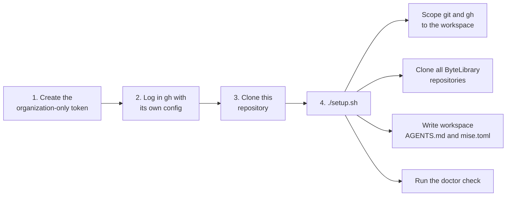

# workbench

Sets up a ByteLibrary development workspace on a new machine: scoped GitHub access, all
repositories cloned into `~/ByteLibrary/`, workspace-level agent instructions, and a check that
everything works. Decided in ADR-0018 of the organization handbook.



## Prerequisites
Tested on **Ubuntu on WSL2**.

| Tool | Install |
|---|---|
| git | `sudo apt install git` |
| Python 3 with PyYAML | `sudo apt install python3 python3-yaml` (reads the handbook's data) |
| GitHub CLI (`gh`) | `sudo apt install gh` |
| mise | See [mise installation](https://mise.jdx.dev/installing-mise.html), then add `eval "$(mise activate bash)"` to `~/.bashrc` |
| Docker Engine | See [Docker Engine for Ubuntu](https://docs.docker.com/engine/install/ubuntu/), then add yourself to the `docker` group |

Docker Engine runs directly inside WSL2; Docker Desktop is not needed.

## Setup
1. **Create the token**, following [docs/github-access-token.md](docs/github-access-token.md).
2. **Log in** with it, in a ByteLibrary-only `gh` configuration:
   ```bash
   GH_CONFIG_DIR=~/.config/gh-bytelibrary gh auth login --hostname github.com --git-protocol https
   ```
3. **Clone this repository:**
   ```bash
   GH_CONFIG_DIR=~/.config/gh-bytelibrary gh repo clone ByteLibrary/workbench ~/ByteLibrary/workbench
   ```
4. **Run the setup**, and answer its questions:
   ```bash
   ~/ByteLibrary/workbench/setup.sh
   ```

## What the setup changes

| Where | Change |
|---|---|
| `~/.config/gh-bytelibrary/` | The `gh` login with the ByteLibrary-only token |
| `~/.gitconfig-bytelibrary` | Commit identity, GitHub credentials and the organization's git hooks (`hooks/`) for ByteLibrary repositories |
| `~/.gitconfig` | One `includeIf` line that loads the file above only under `~/ByteLibrary/`. With your confirmation, removes machine-wide GitHub credential helpers (a backup is kept). |
| `~/ByteLibrary/` | All ByteLibrary repositories, plus the workspace `AGENTS.md`, `mise.toml` and `ByteLibrary.code-workspace` (opens every repository in VS Code) |

Nothing outside the workspace can use the token.

## Commands
Every script is safe to run again.

| Command | Does |
|---|---|
| `./setup.sh` | Full setup |
| `scripts/doctor.sh` | Checks tools, GitHub access, that the handbook's data matches GitHub, repository settings and workspace |
| `scripts/clone-repositories.sh` | Clones repositories added to the organization since the last run |
| `scripts/write-workspace-files.sh` | Rewrites the workspace `AGENTS.md` and `mise.toml` after they change here |
| `scripts/configure-git-hooks.sh` | Makes every workspace repository use the organization's git hooks |
| `scripts/test-hooks.sh` | Tests the git hooks in a throwaway workspace (also run by CI) |

Scripts that work on every repository only include repositories that follow the handbook's
conventions, identified by a kind topic. The kinds are read from the handbook's
`data/repository-kinds.yaml`, so `clone-repositories.sh` clones the handbook first.

The doctor compares the handbook's data with GitHub in both directions: every repository in
`data/repositories.yaml` (existence, visibility, description, topics) and every repository on GitHub
with a kind topic, plus the project's Context options against `data/contexts.yaml`.

## Git hooks
Every workspace repository uses the hooks in `hooks/` (ADR-0024 of the organization handbook). They run
the rules script from the workspace clone of `reusable-ci-workflows`, the same one CI uses:

| Hook | Refuses |
|---|---|
| `commit-msg` | A message that is not a Conventional Commit (merge commits keep git's own subject), co-author trailers, attribution, and agent tool or vendor names |
| `pre-push` | Pushing to or deleting `main`, and branch names that do not follow `<type>/<issue-number>-<short-description>` |

`--no-verify` skips them; CI and, in public repositories, the `main` ruleset still apply.

## Troubleshooting

| Problem | Fix |
|---|---|
| `gh` says you are not logged in inside the workspace | Your shell does not have `GH_CONFIG_DIR` set. Check that mise is activated in `~/.bashrc` and run `mise trust ~/ByteLibrary/mise.toml`. |
| The token check finds private repositories outside ByteLibrary | The token's resource owner is wrong. Delete it and create a new one with ByteLibrary as resource owner. |
| The doctor reports a difference between the handbook's data and GitHub | Decide which one is wrong. Fix the handbook's data through a pull request, or fix GitHub (an owner) so it matches. |
| The doctor reports that repository settings differ | An owner applies the repository settings from the handbook's repository conventions to that repository. |
| `git push` asks for a password | The repository is outside `~/ByteLibrary/`, or setup has not run. Run `./setup.sh`. |
| Docker checks fail | Start the daemon (`sudo service docker start`) and check you are in the `docker` group. |
| The token expired | Regenerate it (see [docs/github-access-token.md](docs/github-access-token.md#renewing-and-revoking)) and log in again. |
