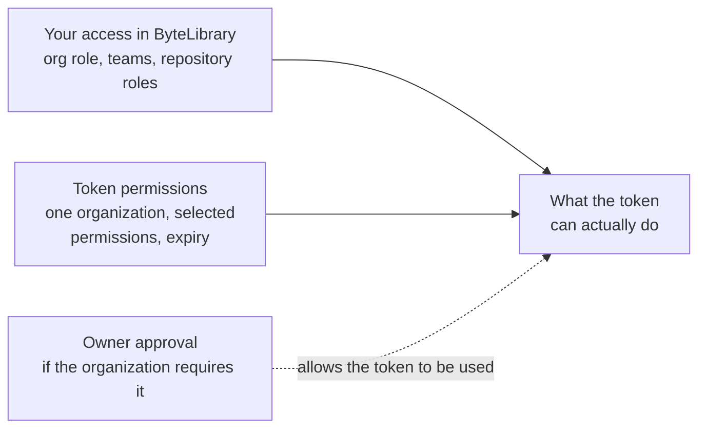

# GitHub access token for ByteLibrary

How to create a **fine-grained personal access token** that can only access the ByteLibrary
organization, and how to use it only inside the ByteLibrary workspace.

This is step 1 of the setup: the token is needed to clone this (private) repository.

## How access works



What a token can do is the **intersection** of your own access and the token's permissions:

- **Your access** comes from your organization role and your teams, granted by an owner. A token
  never adds to it: a member with read access stays read-only, whatever the token requests.
- **The token** narrows that access further: one organization, chosen permissions, an expiry date.
- **Owner approval**, when required, decides whether a token may be used against the organization
  at all. It does not grant access.

To work on repositories you need both: a role that allows it (e.g. membership of a team with write
access), and a token with the matching permissions.

## Why a fine-grained token

| Option | Can it be limited to ByteLibrary? |
|---|---|
| **Fine-grained personal access token** | **Yes.** Each token belongs to exactly one resource owner. |
| Classic personal access token | No. Its scopes apply to everything your account can access. |
| SSH key | No. A personal SSH key has your account's full access. Deploy keys are limited to one repository each. SSH also cannot call the GitHub API (creating repositories, pull requests). |
| `gh auth login --web` | No. Grants the CLI's standard scopes across all your organizations. |

## 1. Allow fine-grained tokens in the organization (once, by an owner)

**ByteLibrary → Settings → Personal access tokens → Settings**

- Allow access via fine-grained personal access tokens.
- If "require administrator approval" is on, approve new tokens under **Pending requests**.

## 2. Create the token

**Your profile → Settings → Developer settings → Personal access tokens → Fine-grained tokens →
Generate new token**

| Field | Value |
|---|---|
| Token name | `bytelibrary-<machine>-cli`, e.g. `bytelibrary-wsl-cli` |
| Description | `GitHub CLI and git on my <machine> development machine. Creates and manages ByteLibrary repositories, pushes commits and opens pull requests. Scoped to the ByteLibrary organization only.` |
| **Resource owner** | **`ByteLibrary`**. Set this first: it defaults to your personal account. |
| Expiration | 90 days |
| Repository access | All repositories. With ByteLibrary as resource owner, this means all *ByteLibrary* repositories, and it is required to create new ones. |

**Repository permissions:**

| Permission | Access | Needed for | Who |
|---|---|---|---|
| Contents | Read and write | Cloning and pushing | Everyone |
| Pull requests | Read and write | Opening and updating pull requests | Everyone |
| Issues | Read and write | Tracking work in issues | Everyone |
| Workflows | Read and write | Pushing files under `.github/workflows/` | Everyone |
| Metadata | Read | Added automatically | Everyone |
| Administration | Read and write | Creating repositories, changing descriptions, topics and settings | Owners and maintainers only |

Request only what your role needs. Without Administration you can still do all day-to-day work;
new repositories are then created by an owner.

**Organization permissions:** none.

Copy the token when it is shown; GitHub shows it only once. Use one token per machine, so a lost
machine means revoking one token.

## 3. Log in, in a ByteLibrary-only gh configuration

Run in your own terminal. The token is pasted at the prompt, so it never ends up in shell history:

```bash
GH_CONFIG_DIR=~/.config/gh-bytelibrary gh auth login --hostname github.com --git-protocol https
```

Choose **Paste an authentication token**.

`GH_CONFIG_DIR` keeps this login separate from any other `gh` login on the machine. Inside the
workspace, `mise` sets it automatically, and `setup.sh` configures git to use it only for
repositories under `~/ByteLibrary/`.

## 4. Verify the scope

```bash
GH_CONFIG_DIR=~/.config/gh-bytelibrary gh api --paginate /user/repos \
  --jq '.[] | select(.private and .owner.login != "ByteLibrary") | .full_name'
```

It must print **nothing**. Fine-grained tokens can always *read public* repositories, so public
repositories of other owners may appear in an unfiltered listing; that is expected. A *private*
repository outside ByteLibrary means the resource owner is wrong: delete the token and create a new one.

`scripts/doctor.sh` runs this check for you.

## Renewing and revoking

- **Before it expires** (GitHub emails a reminder): open the token and choose **Regenerate token**.
  It keeps its settings. Then log in again (step 3).
- **Lost or leaked:** delete it under Developer settings. An organization owner can also revoke it
  under **ByteLibrary → Settings → Personal access tokens → Active tokens**.
- Actions done with the token are recorded under your GitHub account. The organization's active
  token list and audit log show which token was used.
