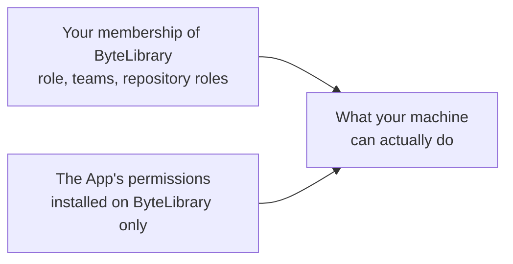

# GitHub access for ByteLibrary

Developers, and the agents working for them, sign in through the **ByteLibrary Developer Access**
GitHub App, owned by the organization (ADR-0026 of the organization handbook). Nobody creates or
configures a personal access token.

## How access works

What your machine can do is the **intersection** of two things:

- **Your membership** of ByteLibrary, granted by an owner. Signing in never adds to it: anyone can
  sign in to the App, but someone who is not a member reaches nothing private.
- **The App's permissions,** the same for everyone and changed only by an owner. The App is installed
  on ByteLibrary only, so its tokens cannot reach anything else.

The token acts as **you**: commits, issues and pull requests show your name, and GitHub's audit log
shows that they went through the App.

## Signing in
`setup.sh` signs you in. It prints a code; open <https://github.com/login/device>, enter the code and
approve **ByteLibrary Developer Access**. Run `scripts/sign-in.sh` to sign in again at any time, for
example after revoking access.

The token is kept in two places, and used only inside the workspace:

| Where | Used by |
|---|---|
| `~/.config/gh-bytelibrary/` | `gh`, which `mise` points there inside the workspace |
| `~/.config/bytelibrary/git-credentials` (readable only by you) | git, for repositories under `~/ByteLibrary/` only |

The token does not expire: it lasts until you revoke it, or until it is unused for a year.

## Revoking access
Your GitHub settings → **Applications** → **Authorized GitHub Apps** →
**ByteLibrary Developer Access** → **Revoke**
(<https://github.com/settings/apps/authorizations>). This signs out every machine you signed in on.

An owner can cut off everyone at once by suspending or uninstalling the App.

## For owners: the App
**ByteLibrary → Settings → Developer settings → GitHub Apps → ByteLibrary Developer Access.**

| Setting | Value |
|---|---|
| Expire user authorization tokens | Off |
| Enable Device Flow | On (the sign-in with a code) |
| Webhook | Inactive |
| Installed on | ByteLibrary, all repositories; it can be installed nowhere else |

Its permissions are what developers and agents need, and nothing more:

| Permission | Access | Needed for |
|---|---|---|
| Contents | Read and write | Cloning and pushing |
| Pull requests | Read and write | Opening and updating pull requests |
| Issues | Read and write | Creating issues and keeping them up to date |
| Workflows | Read and write | Pushing files under `.github/workflows/` |
| Actions | Read and write | Reading CI results and logs; re-running, cancelling and starting workflows |
| Commit statuses | Read | Reading the combined status of a commit |
| Dependabot alerts | Read | Reading vulnerability alerts for dependencies |
| Code scanning alerts | Read | Reading code scanning findings |
| Metadata | Read | Added automatically |
| Projects (organization) | Read and write | Keeping issue status current on the organization project |

**Changing permissions:** edit them on the App. An owner then approves the change for the ByteLibrary
installation (GitHub sends a request), and every existing token gets the new permissions; nobody signs
in again.

## For owners: CI
CI cannot approve a sign-in, so it uses the **`bytelibrary-ci`** account: a member of ByteLibrary,
not an owner, with two-factor authentication. Its fine-grained personal access token is the only one
in ByteLibrary:

| Field | Value |
|---|---|
| Token name | `workbench-ci` |
| Resource owner | ByteLibrary |
| Expiration | One year |
| Repository access | All repositories |
| Permissions | Contents: Read; organization Projects: Read |
| Stored as | Secret `SETUP_TOKEN` in `workbench` |

Before it expires, regenerate it as `bytelibrary-ci` and update the secret.

## Moving from a personal access token
Setup offers the switch when the workspace still uses a personal access token. After signing in, delete
the old token: your profile → **Settings** → **Developer settings** → **Personal access tokens** →
**Fine-grained tokens** → **Delete**.
