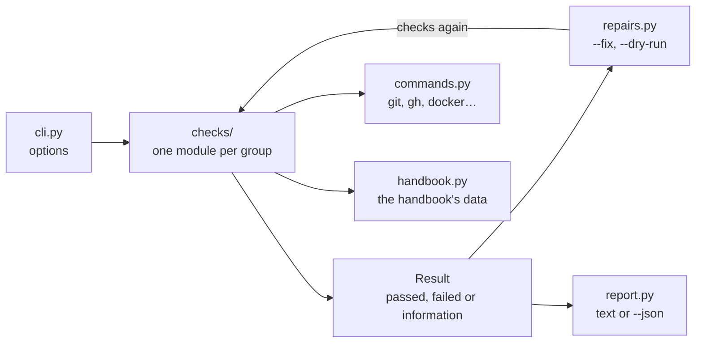

# The doctor

Checks the development machine and the workspace, and repairs what is safe to repair.

How to run it is in its help, `mise run doctor -- --help`; this page is for changing it.

## How the parts connect
The command runs every group of checks, each returning results; with `--fix`, the failed results that
have a safe repair are repaired and everything is checked again; then the results are reported.

| Module | Does |
|---|---|
| `cli.py` | The command line: options, and the order of checking, repairing and reporting |
| `checks/__init__.py` | Every group of checks, by the name `--skip` takes, and running them |
| `checks/tools.py` | Tools at their pinned versions, and Docker |
| `checks/firewall.py` | The site allowlist, and folders of the developer's computer mounted in the machine |
| `checks/credentials.py` | Credentials besides the ByteLibrary sign-in and the developer's agent CLI's |
| `checks/ports.py` | Local ports, against the handbook's port data |
| `checks/sign_in.py` | The developer's sign-in through the ByteLibrary Developer Access App |
| `checks/github_data.py` | Repository settings, and the handbook's data, against GitHub |
| `checks/workspace.py` | The workspace's files, clones, git hooks, the playbook and the background update |
| `repairs.py` | What `--fix` repairs, each by running a step of setup again |
| `report.py` | The results as text, or as one JSON document |
| `results.py` | `Result`: what a check found, how to fix it, and its repair if it has one |
| `commands.py` | Running other programs; checks never call `subprocess` themselves |
| `handbook.py`, `settings.py` | The handbook's data tables, and where things are on the machine |

## Adding a check
1. Add it to the module of its group, or add a module to `checks/` and register it in
   `checks/__init__.py`.
2. Yield a `Result` with what to do when it fails (`fix`). Give it a `repair` only if repairing is safe
   to do without asking: never for anything hard to undo, such as deleting credentials.
3. Put the logic that decides (parsing, comparing) in a function that takes its inputs, and test that
   function in `tests/`. The check itself only gathers the inputs with `commands.py`.
